# Active Directory Home Lab


**Deutsch** | [English](README.en.md)

Virtuelle Windows-Domänenumgebung mit **Windows Server 2022** (AD DS, DNS, DHCP, NAT) und einem **Windows-11-Client**, vollständig selbst aufgebaut und dokumentiert. Das Projekt dient zur praktischen Vorbereitung auf eine Ausbildung als **Fachinformatiker/in für Systemintegration**.

---

## Inhalt

- [Projektübersicht](#projektübersicht)
- [Kompetenzen](#kompetenzen)
- [Architektur](#architektur)
- [Umsetzung](#umsetzung)
- [Herausforderungen und Lösungen](#herausforderungen-und-lösungen)
- [Sicherheit](#sicherheit)
- [Erkenntnisse](#erkenntnisse)
- [Nächste Schritte](#nächste-schritte)
- [Repository-Struktur](#repository-struktur)

---

## Projektübersicht

**Ziel:** Eine kleine Unternehmensumgebung nachbilden, wie sie in vielen Betrieben mit Windows-Infrastruktur vorkommt, und dabei die grundlegenden Dienste selbst installieren, konfigurieren und verstehen.

**Ergebnis:**

- Domain Controller `DC01` mit der neuen Gesamtstruktur **`oliveira.com`**
- DNS (in AD integriert) und DHCP für das interne Netzwerk
- Internetzugang für interne Clients über **NAT** (Routing and Remote Access)
- Eigene Organisationseinheiten, separates Administratorkonto
- Automatisierte Anlage von mehreren hundert Benutzern per **PowerShell**
- Windows-11-Client `CLIENT01` im internen Netzwerk

---

## Kompetenzen

| Bereich | Umsetzung im Lab |
|---|---|
| Virtualisierung | Zwei VMs in VirtualBox, NAT-Netzwerk und internes Netzwerk |
| Windows Server | Installation von Windows Server 2022, Rollenverwaltung über den Server Manager |
| Verzeichnisdienste | AD DS, neue Gesamtstruktur, Organisationseinheiten, Benutzer und Gruppen |
| Netzwerktechnik | Statische IP-Adressierung, Subnetz `/24`, DNS, DHCP, NAT und Routing |
| Automatisierung | PowerShell-Skript zur Massenanlage von Benutzerkonten |
| IT-Sicherheit | Separates Admin-Konto, Execution Policy, keine Passwörter im Klartext |
| Fehleranalyse | APIPA-Adresse erkannt, Execution-Policy-Fehler behoben |
| Dokumentation | Schrittweise Dokumentation mit Screenshots (dieses Repository) |

---

## Architektur

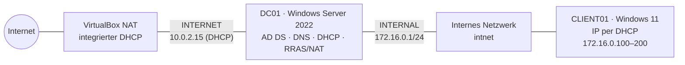

### Virtuelle Maschinen

| VM | Betriebssystem | RAM | vCPU | Netzwerk |
|---|---|---|---|---|
| DC01 | Windows Server 2022 Standard Evaluation (Desktop Experience) | 2 GB | 2 | NAT + internes Netzwerk |
| CLIENT01 | Windows 11 Enterprise Evaluation | 2 GB | 2 | Nur internes Netzwerk |

### Netzwerkplan

| Element | Wert |
|---|---|
| Domäne | `oliveira.com` (NetBIOS: `OLIVEIRA`) |
| Domain Controller | `DC.oliveira.com` |
| Externe Schnittstelle (INTERNET) | VirtualBox NAT, `10.0.2.15` per DHCP |
| Interne Schnittstelle (INTERNAL) | `172.16.0.1` / `255.255.255.0`, DNS `127.0.0.1` |
| DHCP-Bereich | `172.16.0.100` – `172.16.0.200` |
| DNS für Clients | `172.16.0.1` |

---

## Umsetzung

### 1. Vorbereitung und VM für den Domain Controller

Heruntergeladen wurden VirtualBox (inkl. Extension Pack) sowie die Evaluierungs-ISOs von Windows Server 2022 und Windows 11 Enterprise (jeweils 64 Bit). Anschließend wurde die VM **DC01** angelegt: 2 GB RAM, 2 vCPUs, 50 GB Festplatte und zwei Netzwerkadapter (NAT und internes Netzwerk).

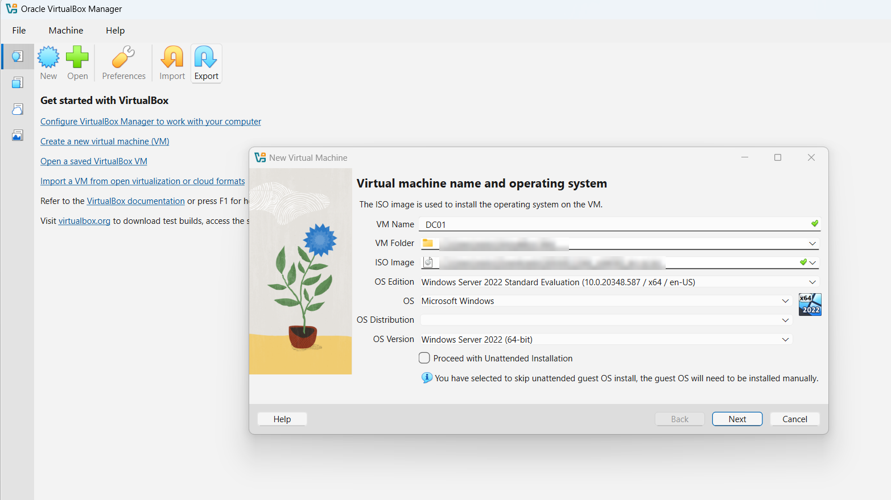

<details>
<summary>Weitere Screenshots</summary>

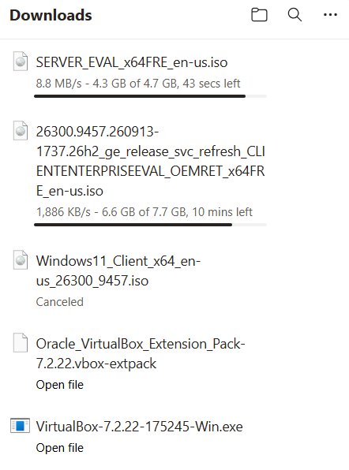

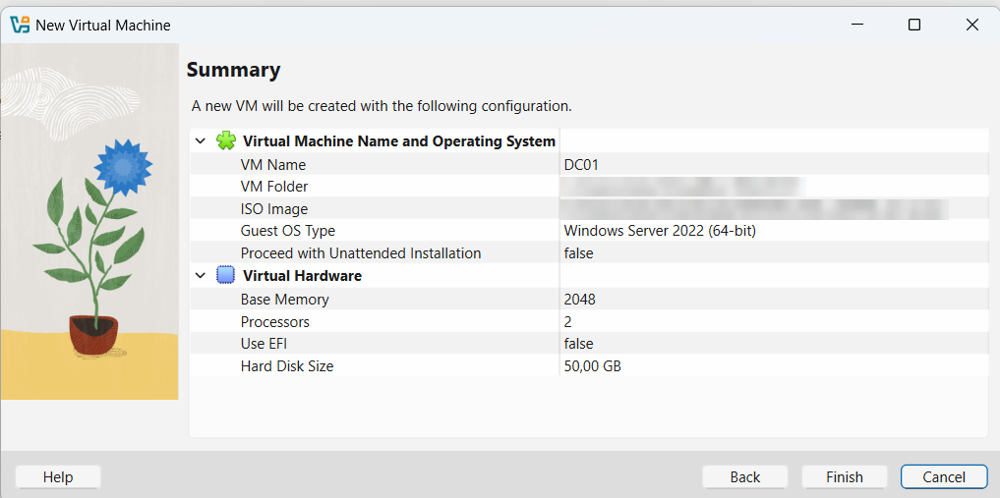

</details>

### 2. Installation von Windows Server 2022

Gewählt wurde die Edition **Standard Evaluation (Desktop Experience)**. Ohne Desktop Experience wird der Server als Server Core installiert und nur über die Kommandozeile verwaltet. Für den Einstieg erleichtert die grafische Oberfläche das Verständnis der einzelnen Schritte; für Aufgaben in großem Umfang ist die Kommandozeile (PowerShell) das richtige Werkzeug, siehe Schritt 8.

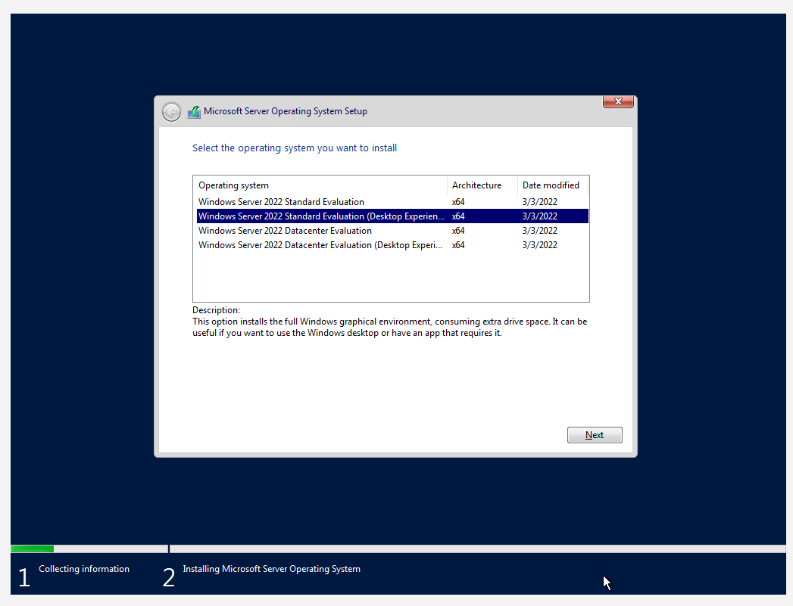

### 3. Netzwerkkonfiguration des Servers

Die Netzwerkadapter wurden zur besseren Übersicht in **INTERNET** und **INTERNAL** umbenannt. Der interne Adapter hatte zunächst eine APIPA-Adresse (`169.254.x.x`), weil im internen Netz noch kein DHCP-Server existierte. Da der Server Domain Controller wird, erhielt er eine **statische IP-Adresse** und verweist als DNS-Server auf sich selbst.

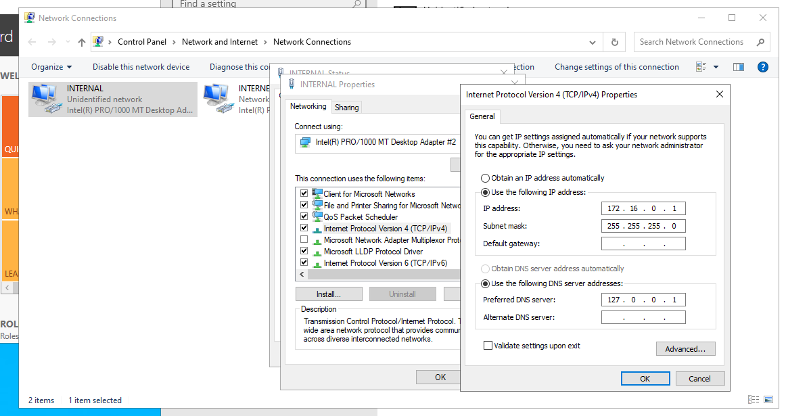

<details>
<summary>Weitere Screenshots</summary>

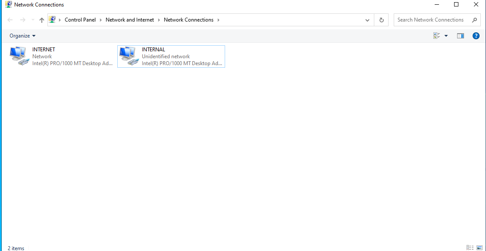

</details>

### 4. Active Directory Domain Services

Über **Server Manager → Rollen und Features hinzufügen** wurde AD DS installiert und der Server zum Domain Controller einer **neuen Gesamtstruktur `oliveira.com`** heraufgestuft. Der DNS-Server wird dabei automatisch mitinstalliert, da Active Directory auf DNS angewiesen ist.

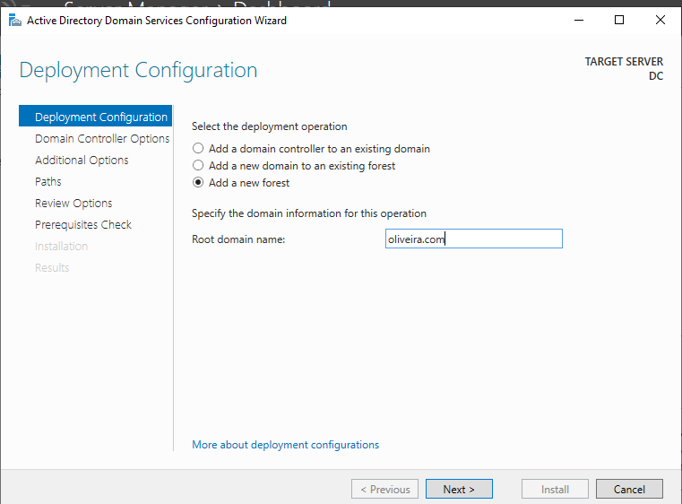

<details>
<summary>Weitere Screenshots</summary>

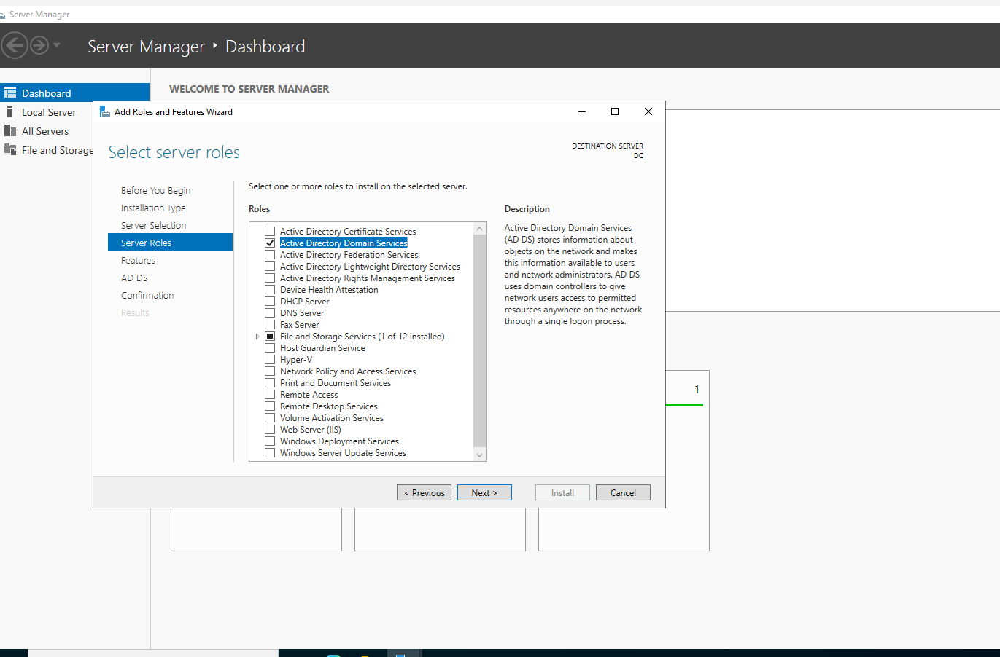

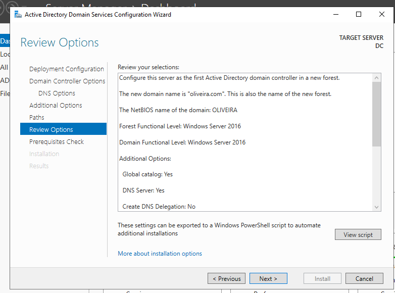

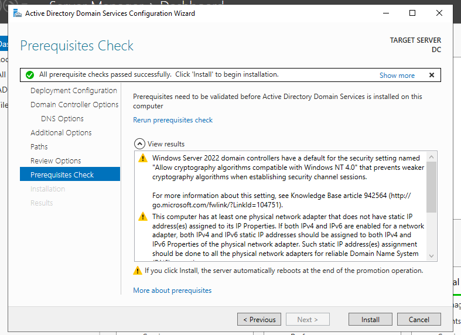

</details>

### 5. Organisationseinheit und Administratorkonto

In **Active Directory-Benutzer und -Computer** wurde die OU **ADMS** angelegt und darin ein persönliches Administratorkonto erstellt, das Mitglied der Gruppe **Domain Admins** ist. Das integrierte Konto `Administrator` wird damit im Alltag nicht mehr verwendet.

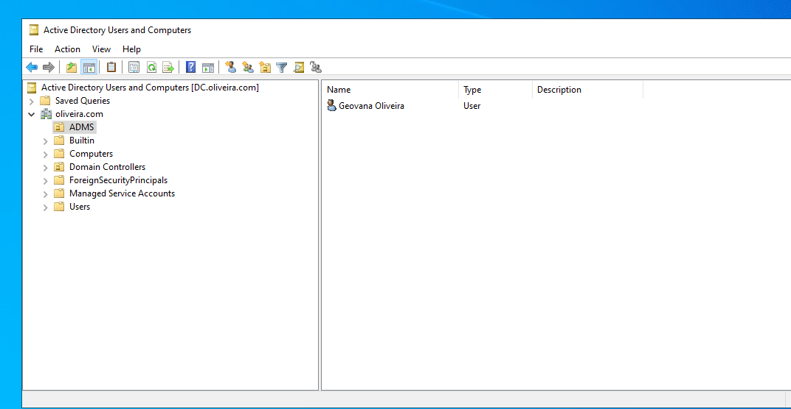

<details>
<summary>Weitere Screenshots</summary>

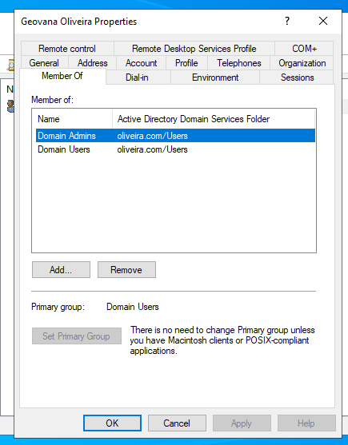

</details>

### 6. Routing und NAT (RRAS)

Damit Clients im internen Netz ins Internet gelangen, wurde die Rolle **Remote Access** mit dem Rollendienst **Routing** installiert. In der Konsole **Routing and Remote Access** wurde **NAT** konfiguriert, mit dem Adapter INTERNET als öffentlicher Schnittstelle. NAT ermöglicht, dass viele interne Clients über eine einzige öffentliche IP-Adresse kommunizieren.

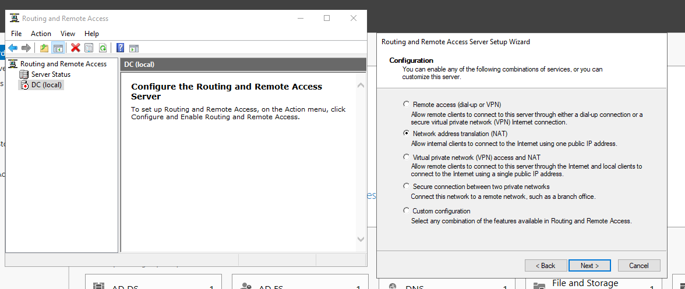

<details>
<summary>Weitere Screenshots</summary>

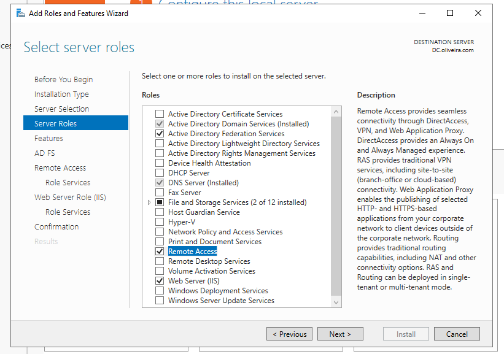

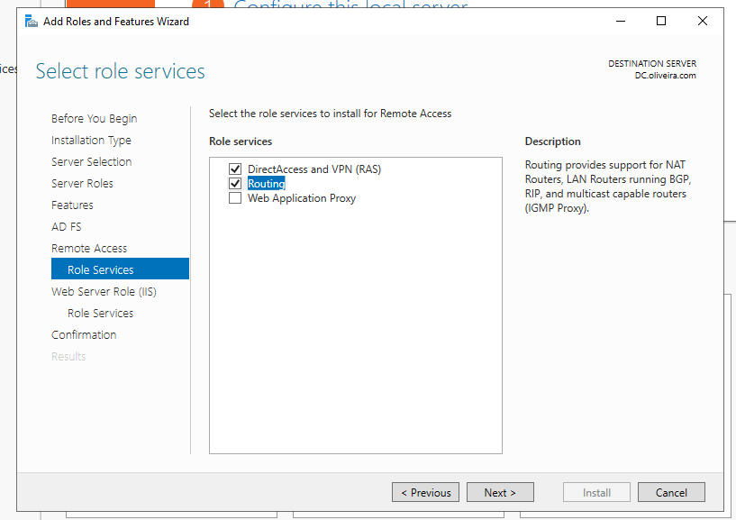

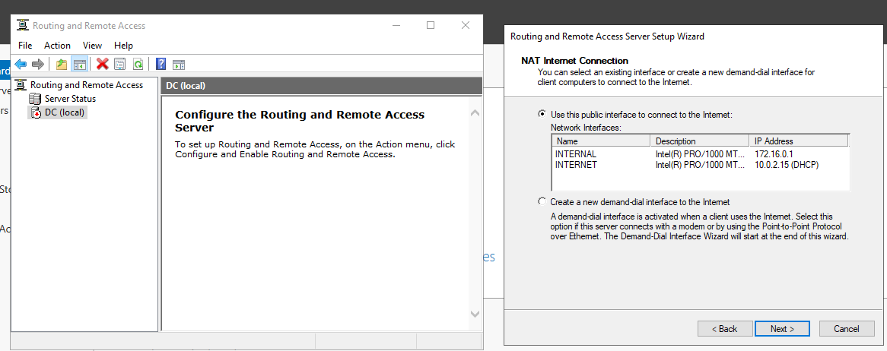

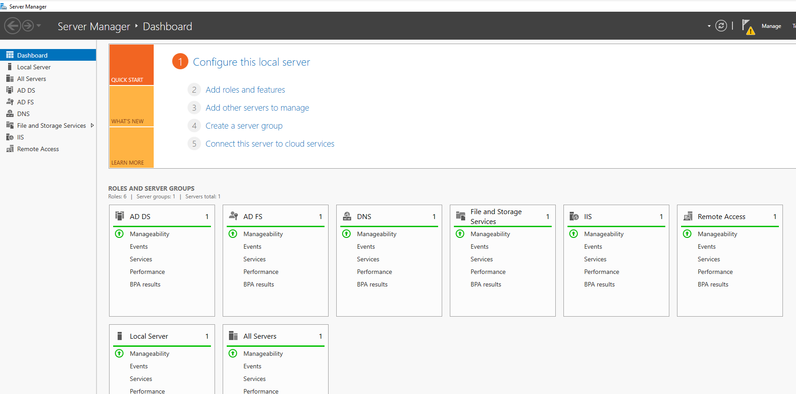

</details>

### 7. DHCP-Server

Auf dem Domain Controller wurde die Rolle **DHCP-Server** installiert und ein Bereich `172.16.0.100–172.16.0.200` (`/24`) angelegt. Als Bereichsoptionen werden die Domäne `oliveira.com` und der DNS-Server `172.16.0.1` an die Clients verteilt.

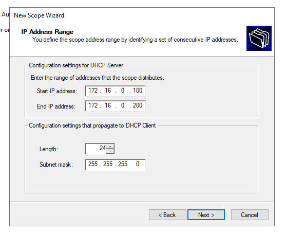

<details>
<summary>Weitere Screenshots</summary>

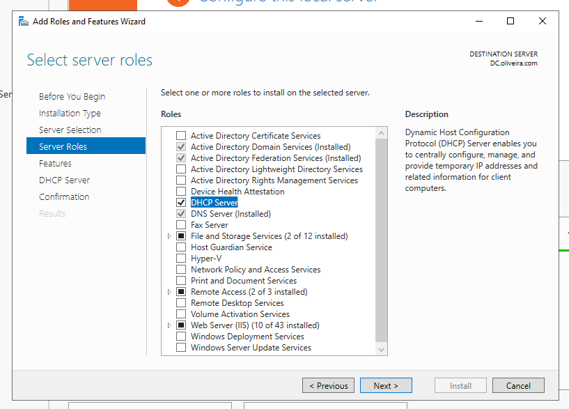

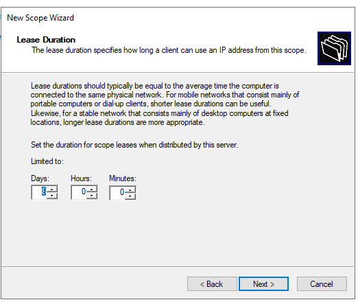

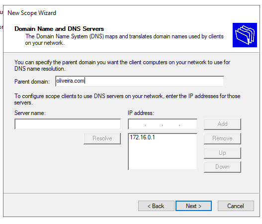

</details>

### 8. Massenanlage von Benutzern mit PowerShell

Das Skript [`scripts/Create-BulkADUsers.ps1`](scripts/Create-BulkADUsers.ps1) liest Namen aus `names.txt`, legt die OU `_USERS` an und erstellt pro Name ein Konto nach dem Schema *erster Buchstabe des Vornamens + Nachname* (z. B. `abirk`). Das Startpasswort wird zur Laufzeit abgefragt und steht nicht im Skript.

```powershell
$password = Read-Host -Prompt "Initial password for the users" -AsSecureString
New-ADOrganizationalUnit -Name _USERS -ProtectedFromAccidentalDeletion $false

foreach ($n in Get-Content .\names.txt) {
    $first    = $n.Split(" ")[0].ToLower()
    $last     = $n.Split(" ")[1].ToLower()
    $username = "$($first.Substring(0,1))$($last)"
    New-ADUser -Name $username -GivenName $first -Surname $last `
               -AccountPassword $password -Enabled $true `
               -Path "ou=_USERS,$(([ADSI]`"").distinguishedName)"
}
```

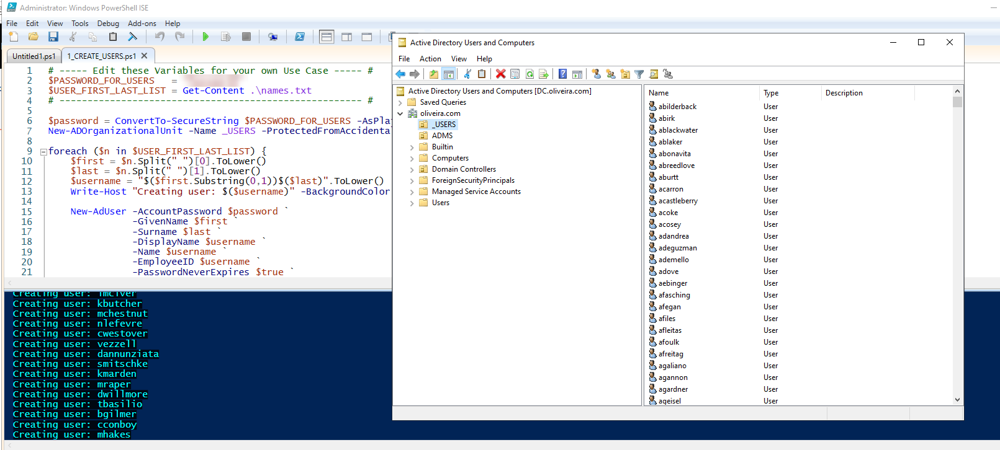

<details>
<summary>Weitere Screenshots</summary>

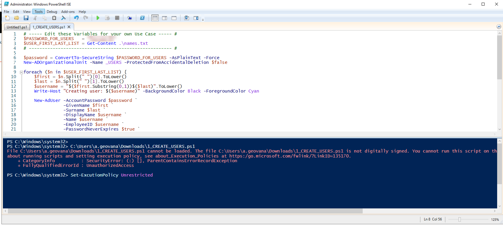

</details>

### 9. Client-VM

Die VM **CLIENT01** mit Windows 11 Enterprise ist ausschließlich mit dem internen Netzwerk `intnet` verbunden. Sie ist damit für IP-Adresse (DHCP), Namensauflösung (DNS) und Internetzugang (NAT) vollständig auf den Domain Controller angewiesen.

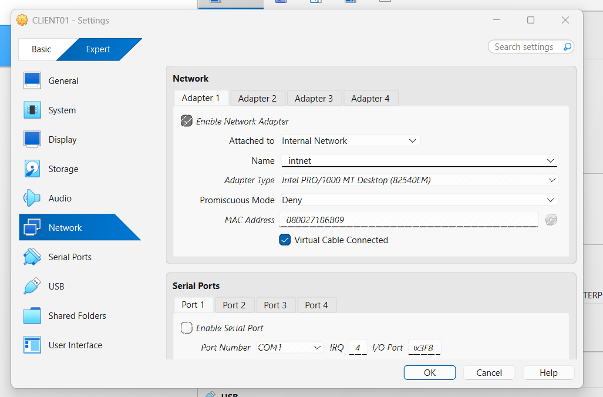

<details>
<summary>Weitere Screenshots</summary>

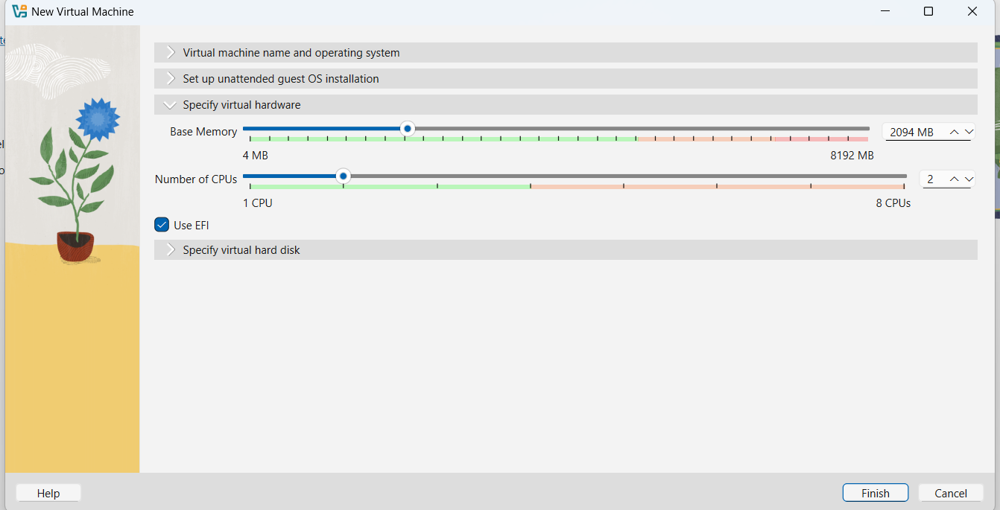

</details>

---

## Herausforderungen und Lösungen

| Problem | Ursache | Lösung |
|---|---|---|
| Interner Adapter mit Adresse `169.254.x.x` | APIPA: Windows fand im internen Netz keinen DHCP-Server | Statische IP `172.16.0.1/24` am DC; DHCP-Server für die Clients eingerichtet |
| PowerShell-Skript wurde blockiert („not digitally signed“) | Execution Policy erlaubt keine unsignierten Skripte | Execution Policy angepasst (sicherer: `Set-ExecutionPolicy Bypass -Scope Process`) |
| Warnungen bei der Voraussetzungsprüfung (DNS-Delegierung, IPv6) | Isolierte Lab-Domäne ohne übergeordnete DNS-Zone, IPv6 nicht statisch konfiguriert | Geprüft und bewusst akzeptiert, für das Lab unkritisch |
| Interne Clients ohne Internetzugang | Internes Netzwerk hat kein eigenes Gateway | NAT über RRAS auf dem DC, Adapter INTERNET als öffentliche Schnittstelle |

---

## Sicherheit

- **Keine sensiblen Daten im Repository:** Das Skript fragt das Passwort zur Laufzeit ab; Passwörter und persönliche Pfade sind in den Screenshots unkenntlich gemacht.
- **Separates Administratorkonto** statt des integrierten Kontos `Administrator`.
- **Nur für die Laborumgebung:** `PasswordNeverExpires` und eine gelockerte Execution Policy wären in Produktion nicht vertretbar. Dort gehören starke Passwörter, Passwortänderung bei der ersten Anmeldung (`-ChangePasswordAtLogon $true`) und Kennwortrichtlinien per GPO dazu.

---

## Erkenntnisse

- Active Directory funktioniert nicht ohne korrektes DNS. Deshalb zeigt der DC auf sich selbst und verteilt seine eigene IP als DNS-Server.
- Eine APIPA-Adresse ist ein klares Diagnosezeichen für einen fehlenden oder nicht erreichbaren DHCP-Server.
- Die grafische Oberfläche hilft beim Lernen; PowerShell ist für wiederkehrende Aufgaben und Aufgaben in großem Umfang unverzichtbar.
- Im Lab übernimmt der Domain Controller viele Rollen gleichzeitig (DNS, DHCP, NAT). Testweise wurden auch AD FS und IIS installiert. In einer Produktivumgebung würde man Rollen trennen und auf dem DC nur das Nötigste installieren, um die Angriffsfläche klein zu halten.
- Für echte Umgebungen empfiehlt sich als Domänenname eine Subdomäne einer eigenen registrierten Domain (z. B. `ad.firma.de`).

---

## Nächste Schritte

- [ ] CLIENT01 der Domäne `oliveira.com` beitreten lassen
- [ ] DHCP-Zuweisung (`ipconfig /all`) und Internetzugang am Client prüfen
- [ ] Anmeldung am Client mit einem per Skript erstellten Benutzer
- [ ] Gruppenrichtlinien (GPO) erstellen, z. B. Kennwortrichtlinie und Laufwerkszuordnung
- [ ] Sicherheitsgruppen und NTFS-Berechtigungen auf Freigaben

---

## Repository-Struktur

```
├── README.md                      Deutsch
├── README.en.md                   English
├── scripts/
│   └── Create-BulkADUsers.ps1     PowerShell-Skript zur Benutzeranlage
└── screenshots/                   Screenshots der einzelnen Schritte
```

> Hinweis: Alle Systeme laufen ausschließlich in einer isolierten Laborumgebung mit Evaluierungslizenzen von Microsoft.
